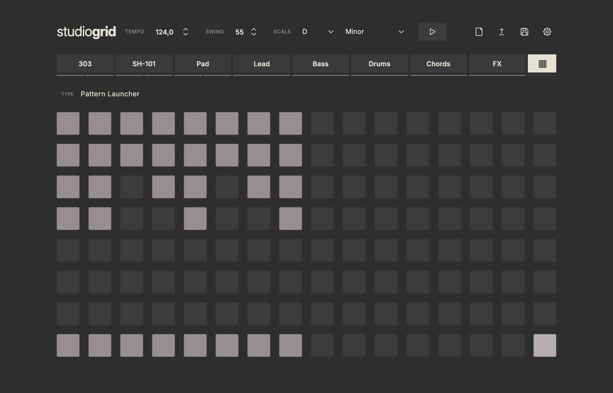
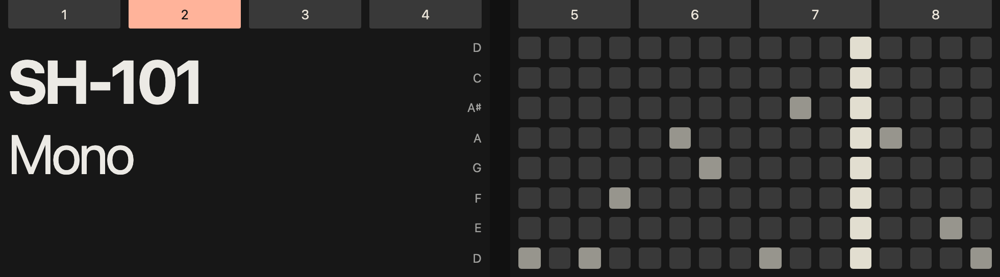

# studio:grid

studio:grid is a MIDI step sequencer for hardware synths and drum machines. Build patterns on the desktop grid or a Monome, and use an optional Native Instruments controller as a second interface.

- Sequence up to eight tracks in Mono, Poly, Drum, CC or Machinedrum tonal mode.
- Build and launch patterns, copy bars, and edit per-note accent, slide, octave and timing.
- Set MIDI routing per track, sync to internal or external MIDI clock, and import or export TD-3 patterns.
- Use the NI bridge to view the grid and control tracks, patterns and parameters from the controller’s two displays.

[User manual](docs/manual/README.md) · [NI controller guide](docs/manual/ni-controller.md) · [Development and builds](docs/manual/development.md)

## Screens

## License

Studio Grid is licensed under the [GNU General Public License, version 3 or later](LICENSE). The [NOTICE](NOTICE) file preserves the MIT notice for portions previously released under that license.
