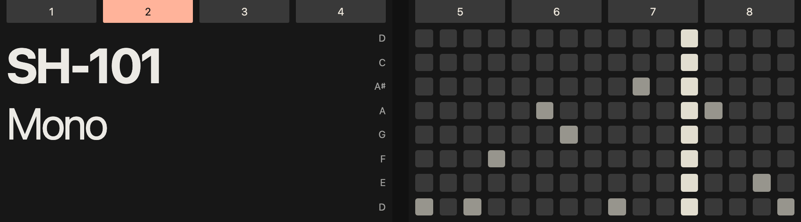

# Native Instruments bridge

The optional macOS bridge brings Studio Grid to the dual displays on supported Komplete Kontrol and Maschine controllers. Use the display buttons and knobs to switch tracks and patterns, edit parameters, and control held notes.

[Setup, supported devices, and controls](../../docs/manual/ni-controller.md)
